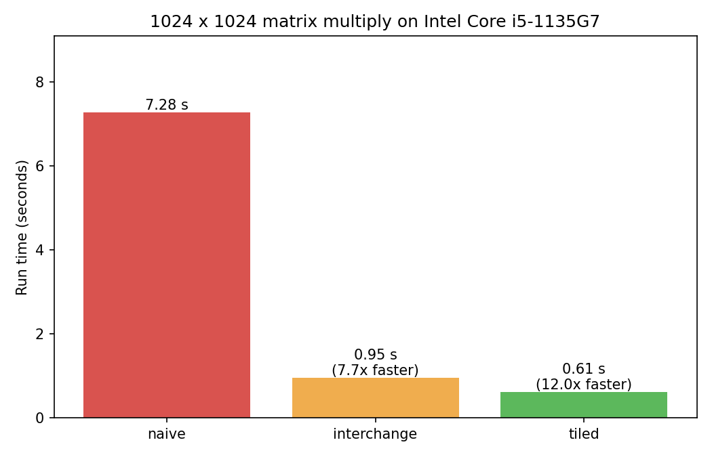
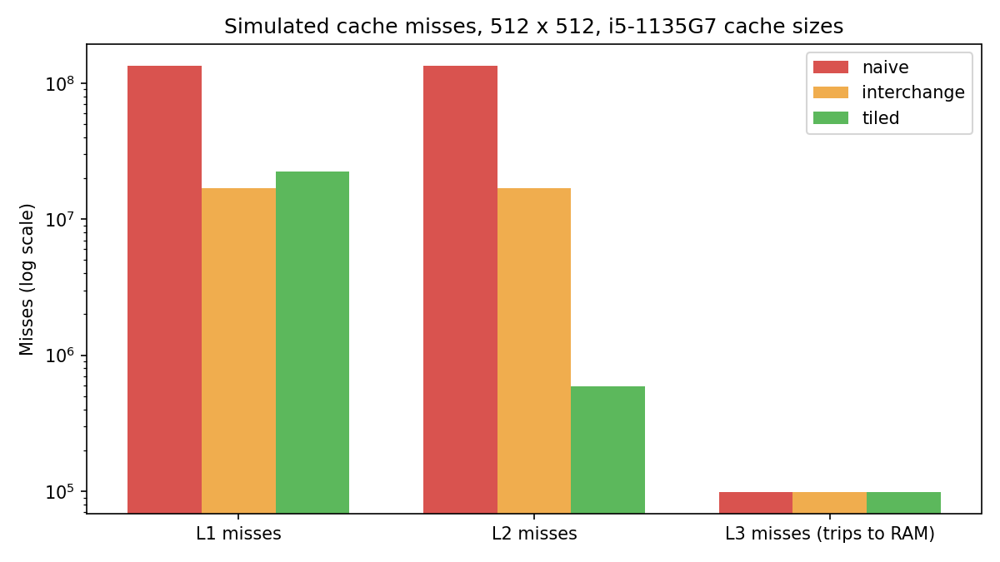
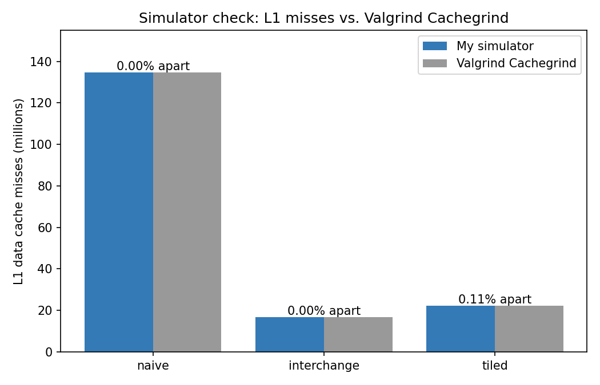

# Matrix Multiply: From CPU Cache to Custom Accelerator

How fast can the same math run when only the **order of memory accesses** changes, and can I prove *why*?

I measured three versions of matrix multiply on my laptop, built a C++ cache simulator modeled on my CPU's real L1/L2/L3 caches to explain the results, and checked the simulator against **Valgrind Cachegrind**.

**Headline results (Intel Core i5-1135G7):**
- **12.0× faster** (7.28 s → 0.61 s) for a 1024 × 1024 multiply, from loop interchange and tiling alone, with identical results
- Cache simulator matches Cachegrind to within **9 and 14 misses** for naive and interchange (out of 134.8 M and 16.8 M) and **0.11%** (tiled)
- Tiling cuts simulated L2 misses by **228×** compared with the naive version



---

## The idea in one minute

A CPU reads memory in 64-byte **cache lines** (8 numbers at a time). Reading numbers one after another uses all 8; jumping around in memory wastes 7 of them and forces slow trips to bigger, slower caches.

| Version | Loop order | How it reads matrix B | Cache behavior |
|---|---|---|---|
| Naive | i, j, k | Down a column (jumps 1024 numbers each step) | Misses L1 on almost every read of B |
| Loop interchange | i, k, j | Along a row (one number after the next) | Uses all 8 numbers in each cache line |
| Tiled | 32 × 32 blocks | Along a row, inside a small tile | Tile stays in cache and is reused many times |

All three compute exactly the same answer (identical checksums).

## Results

### 1. Real run time on my laptop (1024 × 1024, `g++ -O2`)

| Version | Time | Speedup |
|---|---|---|
| Naive | 7,282 ms | 1× |
| Loop interchange | 949 ms | 7.7× |
| Tiled (32 × 32) | 606 ms | 12.0× |

Single run; times vary slightly from run to run.

### 2. Simulated cache misses (512 × 512, my CPU's cache sizes)

| Version | L1 misses | L2 misses | L3 misses (trips to RAM) |
|---|---|---|---|
| Naive | 134.8 M | 134.8 M | 98,307 |
| Loop interchange | 16.8 M | 16.8 M | 98,307 |
| Tiled | 22.3 M | 0.59 M | 98,307 |



**What this shows:**
- **Interchange has 8× fewer L1 misses than naive,** because each 64-byte line now delivers all 8 numbers it holds instead of 1.
- **Naive and interchange almost never hit in L2.** Each matrix is 2 MB, larger than the 1.25 MB L2, and both versions sweep the whole of B before reusing any of it. Tiled reuses an 8 KB tile many times, so 97% of its L1 misses are caught by L2.
- **Tiled has more L1 misses than interchange but runs faster.** Its L1 misses are served by the fast L2, while interchange's fall through to the much slower L3.
- **Trips to RAM are equal for all three.** All three matrices together (6 MB) fit in the 8 MB L3, so each cache line is loaded from RAM only once: 6 MB ÷ 64 B ≈ 98,304.

### 3. Checking the simulator against Valgrind Cachegrind

Cachegrind was configured with the same cache sizes (`--D1=49152,12,64 --LL=8388608,8,64`). Cachegrind also counts misses from creating the matrices and computing the checksum, so I measured that separately (`setup-only`: 212,008 misses) and subtracted it.

| Version | My simulator (L1 misses) | Cachegrind minus setup | Difference |
|---|---|---|---|
| Naive | 134,809,089 | 134,809,098 | 9 (0.000%) |
| Loop interchange | 16,843,266 | 16,843,280 | 14 (0.000%) |
| Tiled | 22,281,970 | 22,307,049 | 25,079 (0.112%) |



**Open question:** the tiled version has a small remaining gap (0.11%) that I have not explained yet. Next step is to look at Cachegrind's per-line counts (`cg_annotate`) to find where it comes from.

## My hardware (from `lscpu -C`)

| Cache | Size | Ways | Sets | Line size |
|---|---|---|---|---|
| L1 data | 48 KB | 12 | 64 | 64 B |
| L2 | 1.25 MB | 20 | 1024 | 64 B |
| L3 (shared by 4 cores) | 8 MB | 8 | 16384 | 64 B |

CPU: 11th Gen Intel Core i5-1135G7 ("Tiger Lake"), Ubuntu on WSL2.

## How the simulator works

- Each address is split into a **block number** (`address / 64`), a **set** (`block % number_of_sets`), and a **tag** (`block / number_of_sets`).
- Each set holds several **ways**; on a miss in a full set, the **least recently used** line is replaced.
- Every read and write goes to L1 first, then L2 on an L1 miss, then L3 on an L2 miss.
- The simulator is fed the program's **real memory addresses** while it runs.
- Hand-worked test cases (`test_cache.cpp`) check hits, misses, and LRU replacement.

## How to run

```bash
bash run_all.sh        # build, run tests, time the real program, run the simulation -> results.txt
bash validate.sh       # compare with Valgrind Cachegrind (a few minutes)       -> validation.txt
python3 make_charts.py # draw the charts                                          -> charts/
```

Requires `g++`, `valgrind`, and `python3-matplotlib` on Linux.

## Files

| File | What it does |
|---|---|
| `cache.h` | The cache model: sets, ways, LRU replacement, hit/miss counting |
| `test_cache.cpp` | Small tests with answers worked out by hand |
| `matmul.cpp` | The real program: naive, interchange, and tiled versions, with timing |
| `simulate_matmul.cpp` | Same three versions, with every access sent through a 3-level cache model |
| `run_all.sh`, `validate.sh`, `make_charts.py` | Reproduce every number and chart in this README |
| `results.txt`, `validation.txt` | Raw output from my laptop |

## What's next

- **Part 2:** a TPU-style systolic-array matrix-multiply accelerator in Verilog, verified against the C++ results
- **Part 3:** a CUDA version using GPU shared-memory tiling

---

**Author:** Shashank Meghashyam, M.S. Electrical and Computer Engineering, Northeastern University
